<div align="center">


# Ledger

**A stock research and portfolio workspace I built for myself, because every tool I tried either hid the math or wanted my brokerage password.**

Local-first · single user · runs entirely on your machine · every number explains itself

[](https://nextjs.org)
[](https://react.dev)
[](https://www.typescriptlang.org)
[](https://sqlite.org)
[](#tests)
[](#tests)

<br>

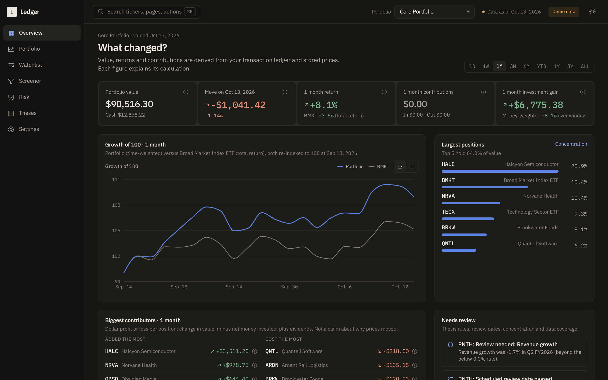

<sub>The overview page. It opens with one question, <em>what changed?</em>, and answers it from your own transaction ledger.</sub>

</div>

<br>

## Why this exists

I own a handful of stocks and ETFs, I like reading filings, and I wanted one place that could answer six questions without making me trust a black box:

1. **What do I own, and what actually drove my returns?**
2. **How concentrated am I?**
3. **Are the companies I follow getting better or worse?**
4. **What assumptions are baked into a valuation?**
5. **What changed since I last looked?**
6. **Does new evidence support my thesis, or weaken it?**

Most portfolio apps answer the first one and stop. The ones that go further tend to show a number with no derivation, pull your data to someone else's server, or quietly fill gaps with made-up values. I wanted the opposite: a tool where the transaction ledger is the single source of truth, the math is written down and tested, and every figure on screen can tell you its definition, period, units, source and limitations when you click the little **i** next to it.

So I built Ledger. It runs on your laptop against a SQLite file. It never sees a brokerage login. It starts up with a complete fictional dataset so you can poke at everything before you decide whether to feed it real data.

<br>

## Try it in two minutes

You need Node.js 22 or newer. That's it.

```bash
git clone https://github.com/nathanu1/Ledger.git
cd Ledger
npm install
npm run dev
```

Open [http://localhost:3000](http://localhost:3000). The first start creates `data/ledger.db`, runs the migrations and loads the demo universe: 12 fictional companies and 3 funds with three and a half years of daily prices, filings, financial statements, two portfolios, a watchlist and a few written-up theses. There are no API keys to find and no network requests. A yellow **Demo data** badge stays in the top bar so you never mistake it for real money.

When you're ready to point it at the real world, see [Connected mode](#connected-mode) below.

<br>

## A walk through the app

Everything below is captured from the demo dataset at 1440 px in the default dark theme. Click any image to see it at full size.

### Overview


The landing page. Portfolio value, the day's move net of flows, the selected period's time-weighted return next to the benchmark, contributions shown separately from investment gain, and the money-weighted return for the same window. Below that: a growth-of-100 chart against the benchmark, your largest positions, the positions that added or cost the most, and a **Needs review** list fed by thesis rules, overdue review dates, concentration and data coverage. The period switcher in the corner re-derives all of it.

### Every figure explains itself

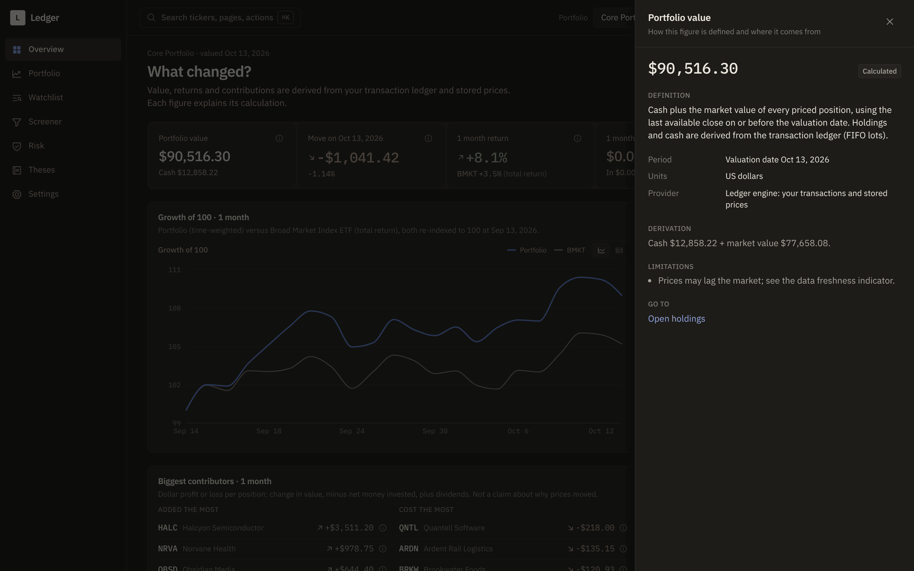

This is the part I care most about. Click the **i** on any metric and a drawer opens with its definition, the period it covers, its units, where the inputs came from, the actual arithmetic that produced the number you're looking at, and what it can't tell you. Values are marked **reported** when they came straight from a filing and **calculated** when Ledger derived them.

### Portfolio

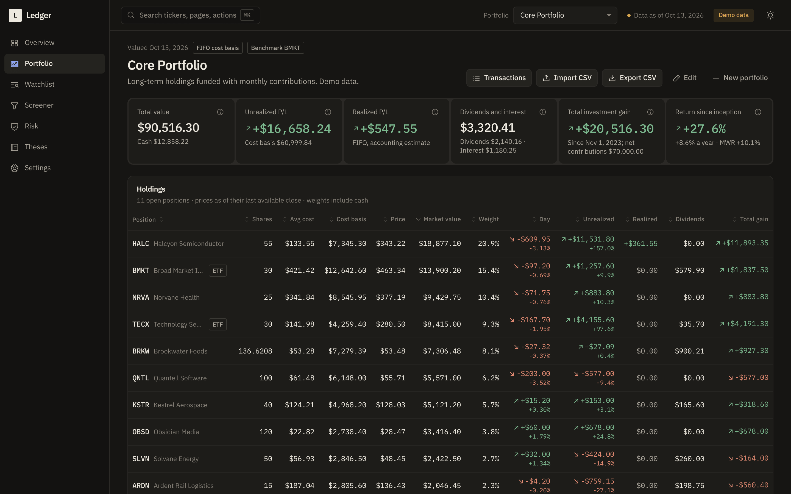

Total value, unrealized and realized profit, dividends and interest, total gain and return since inception, then a sortable holdings table: shares, average cost, cost basis, price with a staleness marker, market value, weight, day change, unrealized and realized P/L, dividends and total gain. Cost basis is FIFO and the page says so. Closed positions stay in the list with their realized result.

### Transactions

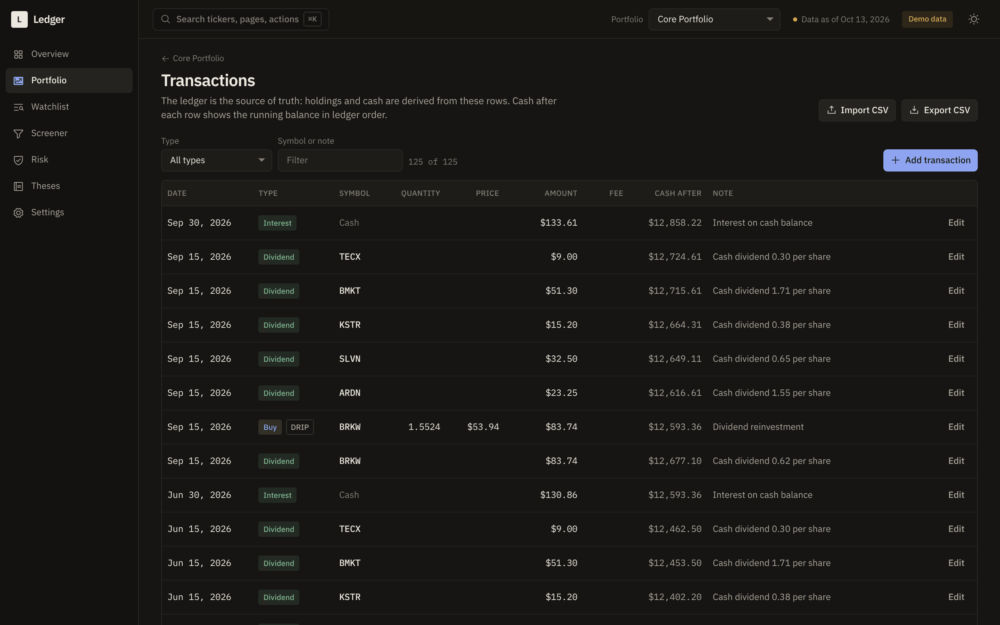

The ledger is the source of truth; holdings and cash are replayed from these rows. Buys, sells, deposits, withdrawals, cash dividends, dividend reinvestment (a linked dividend plus buy, counted once), interest, standalone fees and splits. Each row shows the running cash balance after it. A sell that exceeds what you hold is rejected and shown, not silently applied.

### CSV import

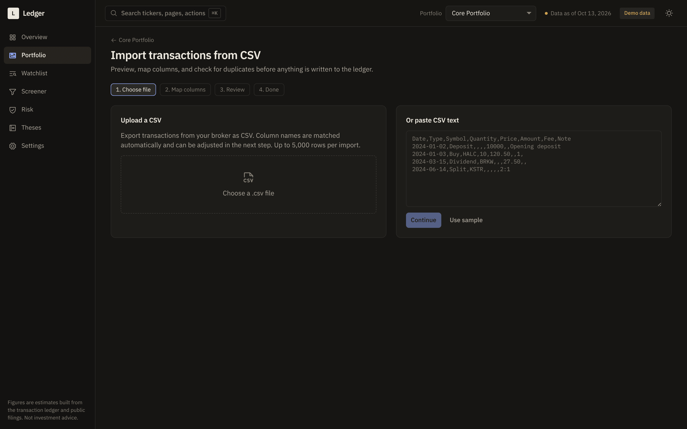

Export transactions from your broker and drop the file in. Ledger guesses the column mapping, lets you fix it, validates every row, and flags duplicates both against the existing ledger and within the file itself before anything is written. Export goes out in the same format, so round trips are lossless.

### Company workspace

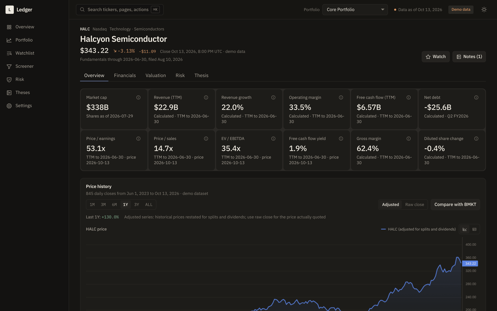

One page per company with five tabs. The overview shows the quote with its timestamp and source, a tile grid of trailing-twelve-month metrics with their period and basis under each number, and a price chart with range buttons, adjusted versus raw closes, a benchmark overlay and a table twin for anyone who prefers rows to lines.

### Financials

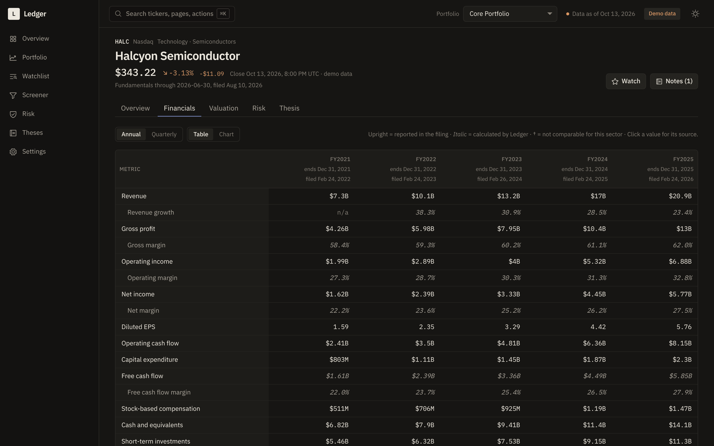

Annual and quarterly statements with the fiscal period end and filing date in every column header. Upright figures came from the filing; italic ones Ledger calculated. Standalone quarters are derived from cumulative cash-flow reporting, trailing twelve months from consecutive quarters, and restatements are handled rather than averaged away. Banks, insurers and REITs get sector-specific labelling where a ratio doesn't apply.

### Valuation lab

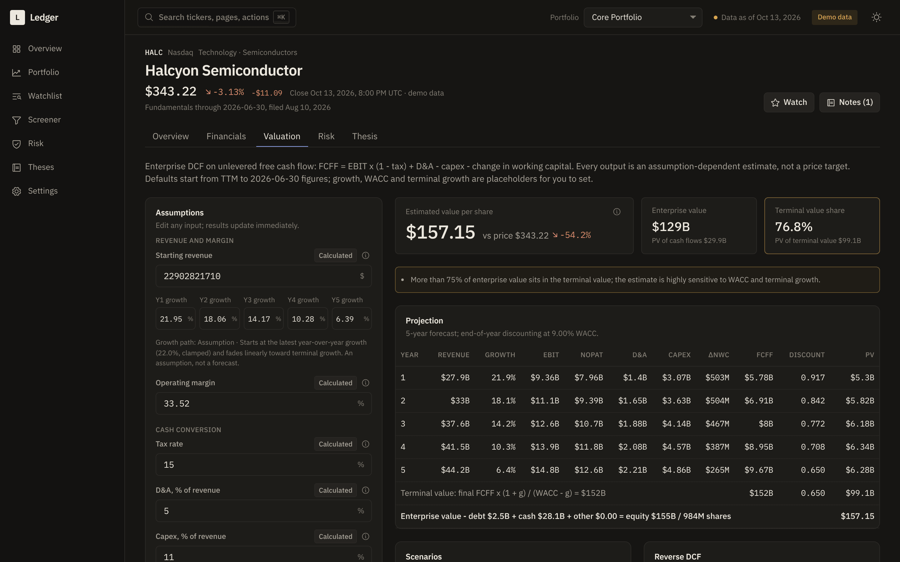

An enterprise discounted cash flow on unlevered free cash flow with every input editable: a five-year growth path, operating margin, tax, D&A, capex, working capital, WACC, terminal growth, cash, debt and diluted shares. Each input carries a badge saying whether it was calculated from filings or is a placeholder for you to set. You get the projection table, the equity bridge, how much of the value sits in the terminal (with a warning when it's most of it), bear/base/bull scenarios, a WACC by terminal growth sensitivity grid, a reverse DCF on one assumption of your choice, and saved scenarios. The page is explicit that outputs are assumption-dependent estimates, not price targets.

### Risk, per company

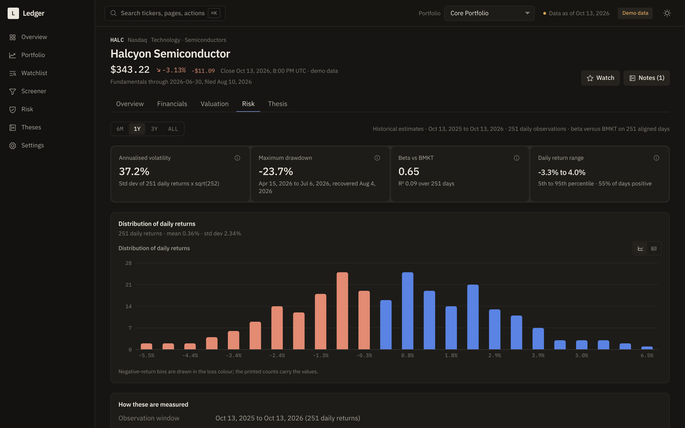

Annualised volatility, maximum drawdown with its dates, beta and R² against the benchmark, and the distribution of daily returns. The conventions (window, return type, annualisation factor, minimum sample, missing-data rule) are printed right under the chart.

### Thesis

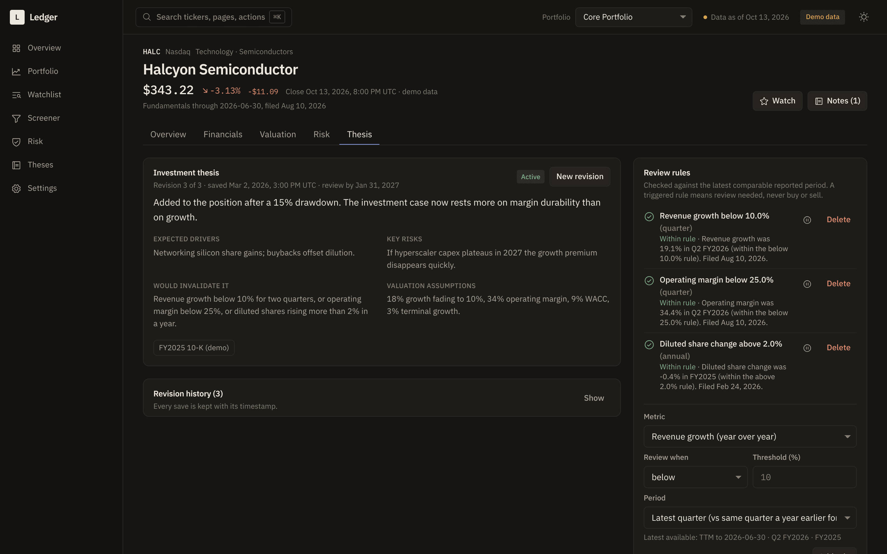

Write down why you own something: expected drivers, key risks, what would prove you wrong, the valuation assumptions you're leaning on, and a review date. Every save is kept as a timestamped revision. On the right, **review rules** turn the invalidation criteria into measurable checks against the latest comparable reported period. A triggered rule says *review needed*, never *buy* or *sell*.

### Risk, whole portfolio

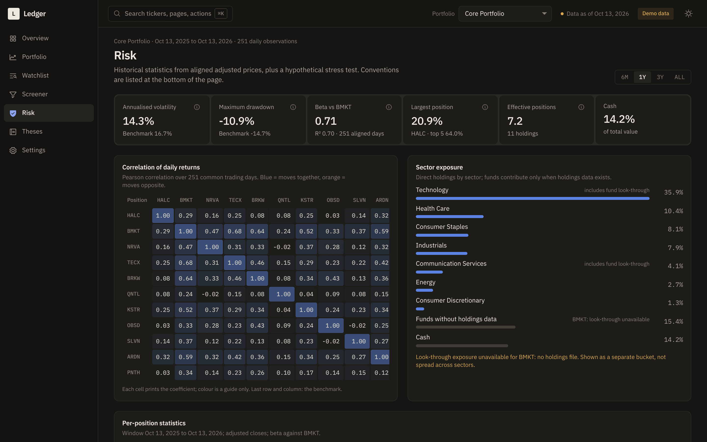

Portfolio volatility, drawdown, beta, concentration (largest position, top five, effective number of positions), a correlation matrix of daily returns, sector exposure with fund look-through where holdings data exists and an honest "look-through unavailable" bucket where it doesn't, per-position statistics, and a stress-test tool for position and sector shocks.

### Watchlist

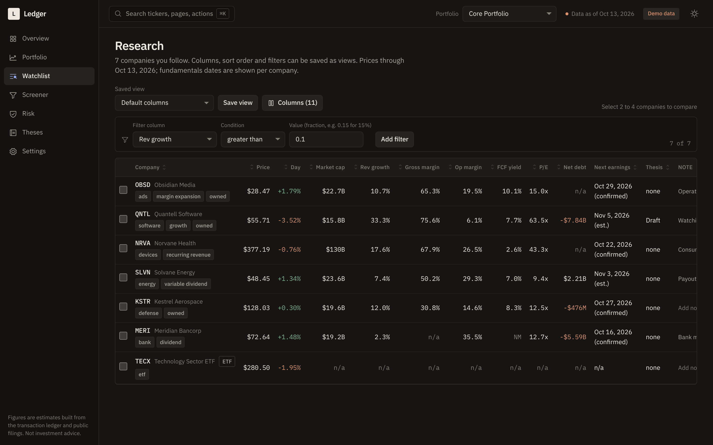

Companies you follow, with research tags, notes, sortable columns, a column picker, filters and saved views. Tick two to four rows to compare them.

### Screener

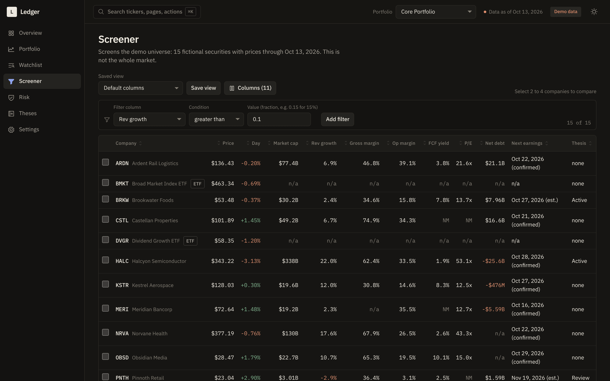

The same table over everything loaded, with a filter builder. It says at the top exactly what universe it's screening and through what date, because it's screening what you've loaded, not the whole market.

### Compare

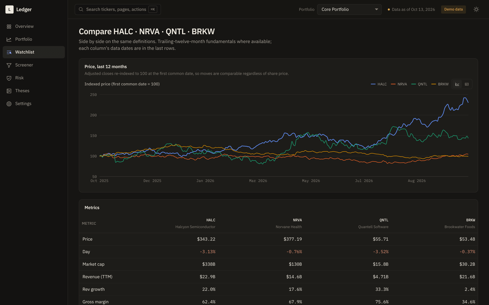

Up to four companies side by side on identical definitions, with a twelve-month price chart re-indexed to 100 at the first common date so moves are comparable regardless of share price. Data dates for each column are in the last rows.

### Thesis journal

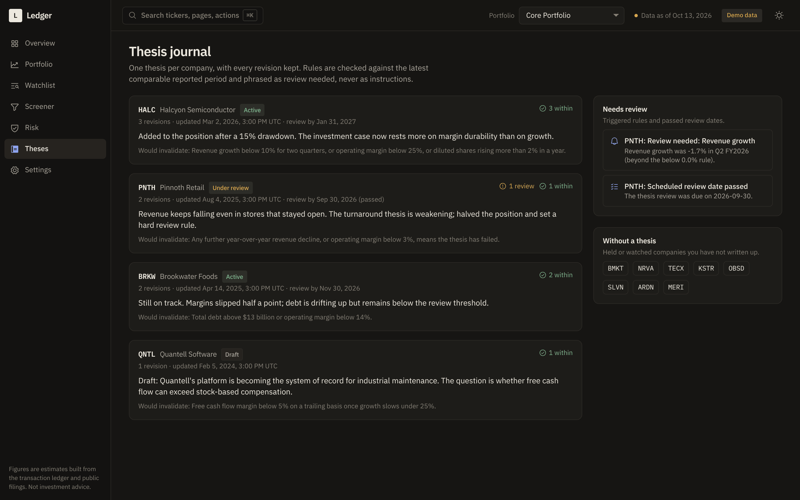

All your theses in one place, with status, revision count, review date, the one-line invalidation criteria, and which rules are within bounds or need a look. It also lists the companies you hold or watch but haven't written up yet, which turned out to be a useful nudge.

### Settings

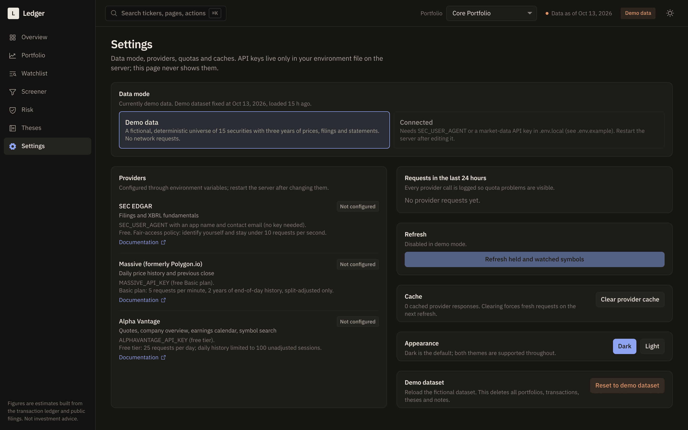

Switch between demo and connected mode, see which providers are configured (keys are never displayed), read the request log with quota and authentication failures, clear the cache, refresh held and watched symbols in bulk, pick a theme, or reset to the demo dataset.

### Command palette

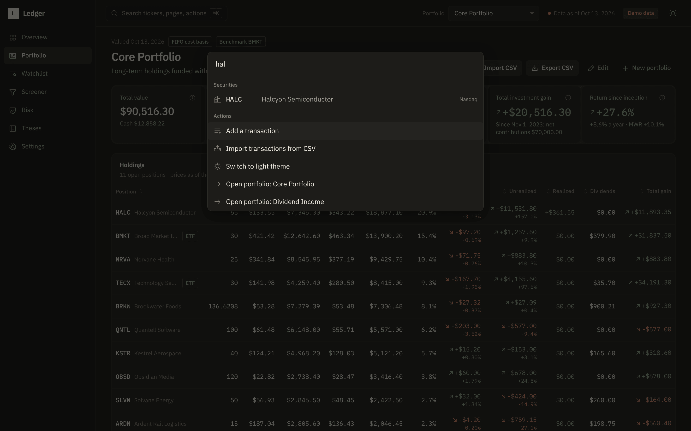

Press **⌘K** (or **Ctrl K**) anywhere to jump to a ticker, a page or an action.

### Light theme and phone

Both themes are first-class, and the layout works at phone width with a bottom tab bar.

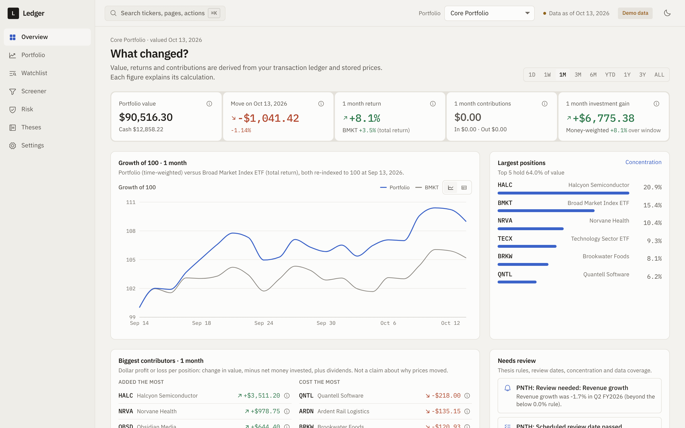

<p align="center">
  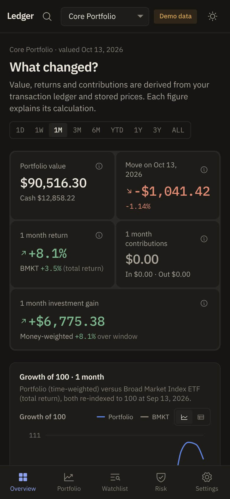
  &nbsp;&nbsp;&nbsp;&nbsp;
  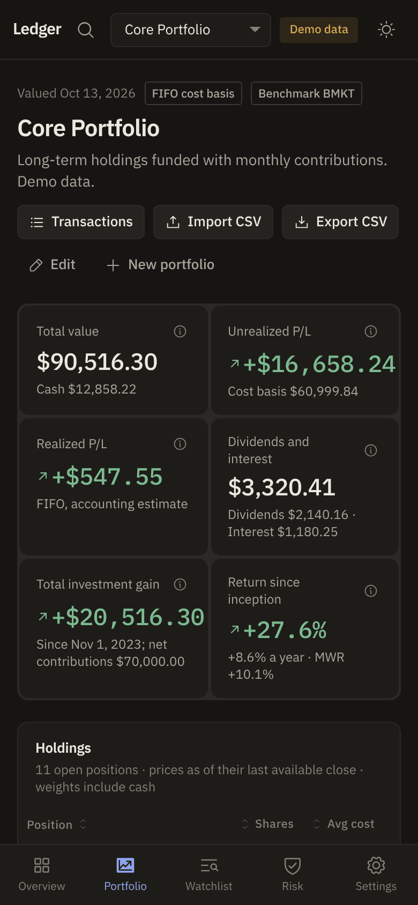
</p>

<br>

## Connected mode

Demo mode is fully usable, but the point is real data. Copy the environment template and fill in whatever you have:

```bash
cp .env.example .env.local
```

| Variable | What it unlocks | Cost |
|---|---|---|
| `SEC_USER_AGENT` | SEC EDGAR: company facts from XBRL, filings list, earnings-date estimates from 8-K cadence. Any string with an app name and a contact email, which the SEC's fair-access policy asks for. | Free, no key |
| `MASSIVE_API_KEY` | Massive (formerly Polygon.io): two years of daily split-adjusted bars, previous close, ticker profiles, search. | Free Basic plan, 5 requests a minute, end of day |
| `ALPHAVANTAGE_API_KEY` | Alpha Vantage: end-of-day quotes, company overview, earnings calendar, symbol search, 100 sessions of unadjusted history. | Free tier, 25 requests a day |

Restart the server, then flip the switch in **Settings**. Keys live on the server and are never sent to the browser.

A few things I was deliberate about in connected mode:

- Opening a company page resolves it through SEC EDGAR (and your market-data provider if configured) and stores filings, facts and prices locally. After that it reads from SQLite.
- Rate limits are respected with backoff, in-flight requests are de-duplicated, responses are cached, and every call is written to the log you can read on the Settings page.
- A failed or rate-limited request leaves the data you already had in place and tells you it failed. Ledger never substitutes a synthetic value for a missing one.
- You can go back to demo mode any time. **Reset to demo dataset** wipes everything and reloads the fictional universe.

Provider documentation was checked in October 2026; endpoints, field names and free-tier limits are recorded at the top of each adapter in `src/providers`. The SEC adapter has been exercised live against real filings. The Massive and Alpha Vantage adapters follow their documented response shapes but I didn't have a paid key to run them against during development, so treat them as the least-tested corner of the app.

<br>

## How the numbers are computed

The whole calculation engine lives in `src/calc` as pure TypeScript whose only dependency is `decimal.js`. Money and share quantities are exact decimals end to end; they become floating point only at the moment a chart draws them.

The conventions are written up in [docs/METHODOLOGY.md](docs/METHODOLOGY.md). The short version:

- **Ledger replay.** Holdings, cash and lots are derived by replaying transactions in order. FIFO lots. Buy-side fees are capitalised. Splits scale lot quantity and leave cost untouched, so cost basis survives exactly. Missing prices are never treated as zero; an unpriced position is listed with its cost basis and excluded from totals, and the page says so.
- **Returns.** Time-weighted return treats external flows as arriving at the start of the day, links daily returns geometrically, and annualises only past 365 days. Money-weighted return is an XIRR solver that scans for sign changes, bisects, polishes with guarded Newton steps, and reports `not_unique` or `no_solution` instead of picking a root for you.
- **Attribution.** Per-position profit is exact: change in value minus net money invested plus dividends. It's a statement about dollars, not a claim about why prices moved.
- **Fundamentals.** XBRL normalisation with concept fallbacks, duplicate handling across filings, restatements, standalone quarters from cumulative cash-flow facts, trailing twelve months from consecutive quarters, and filing-date availability so you never see a number before it was public.
- **Valuation.** FCFF discounted cash flow with end-of-year discounting, an explicit enterprise-to-equity bridge, and defined handling of invalid inputs and negative equity.
- **Risk.** Stated windows, simple daily returns on adjusted closes, square-root-of-252 annualisation, minimum sample sizes, and a documented rule for days with missing data.

<br>

## Under the hood

| | |
|---|---|
| Framework | Next.js 16 (App Router, Turbopack), React 19, TypeScript 5.9 |
| Storage | SQLite via better-sqlite3, Drizzle ORM, migrations in `drizzle/` |
| Numbers | decimal.js for money and quantities |
| Charts | lightweight-charts for price series, Recharts for everything else |
| Interface | Tailwind CSS 4, Radix primitives, cmdk, Phosphor icons, IBM Plex Sans and Mono |
| Validation | Zod for inputs, server actions, and CSV rows |
| Tests | Vitest for the engine, Playwright for end-to-end flows |

```
src/calc        Pure financial engine: ledger replay, valuation, returns, drawdown,
                attribution, fundamentals normalisation, ratios, DCF, risk, CSV import
src/providers   Provider interfaces, rate-limited HTTP client, cache, SEC EDGAR,
                Massive and Alpha Vantage adapters, SIC sector mapping
src/db          Drizzle schema and client
src/demo        Deterministic demo universe, generator and seeder
src/services    Application services joining the database, providers and engine
src/app         Pages, server actions and route handlers
src/components  Shell, primitives, charts, metric explanations, feature components
docs            METHODOLOGY.md (calculation conventions), FEATURES.md (scope and limits)
```

Pages render on the server straight from SQLite. The interactive pieces (charts, tables, the DCF lab, forms) are client components that call server actions. Every externally sourced value keeps its provider, reference, reporting period or market timestamp, units and retrieval time.

On the design side: warm graphite by default and a paper-toned light theme, both built from the same tokens. There is one accent, a quiet cobalt, and it only ever means "interactive": links, the active tab, focus, the primary button. Gains are sage, losses are terracotta, and neither is ever the only signal, since every value also carries a sign, an icon or a label. Summary numbers sit in a single divided strip rather than a row of cards, tabular figures keep columns aligned, and the chart palette was run through a colour-vision validator in both themes. Every chart has a table twin and a text summary.

<br>

## Scripts

| Command | What it does |
|---|---|
| `npm run dev` | Development server with Turbopack |
| `npm run build` / `npm start` | Production build and server |
| `npm test` | Unit tests for the engine and import validation |
| `npm run test:e2e` | Playwright flows against a running or auto-started dev server |
| `npm run typecheck` / `npm run lint` | TypeScript and ESLint |
| `npm run db:seed` | Reload the demo dataset (replaces all data) |
| `npm run db:reset` | Delete the database file |
| `npm run db:generate` | Generate a migration after editing `src/db/schema.ts` |
| `SEC_USER_AGENT="App you@example.com" npx tsx scripts/check-sec.ts AAPL` | Pull a real company from SEC EDGAR and print the normalised statements |
| `node scripts/screenshot.mjs http://localhost:3000/ out.png 1440 900 dark` | Screenshot a page |

<br>

## Tests

Recorded on the current build, October 2026.

- **Unit (Vitest):** 6 files, 68 tests. Cost basis after partial sales across lots, forward and reverse splits with fractional shares, dividend reinvestment counted once, deposits and withdrawals in both return measures (including the non-unique and no-solution XIRR cases), DCF discounting and the equity bridge, invalid valuation inputs, drawdown and correlation, missing prices and mismatched date ranges, standalone-quarter derivation, restatements, TTM construction, and CSV validation with duplicate detection.
- **End to end (Playwright):** 22 of 22 flows, 11 each at desktop 1440×900 and Pixel 7. Period switching and the explanation drawer, holdings sorting, add/edit/delete transactions, a rejected oversell, CSV import with duplicate and error rows, every company tab including a rejected DCF input, bank-specific labelling, watchlist toggles and screener filters, settings and the command palette.
- **Typecheck and lint:** clean.
- **Production build:** compiles; every page is server-rendered on demand.

<br>

## What it doesn't do

I'd rather you find these here than in a surprise.

- **USD, US-listed stocks and ETFs only.** No other currencies, no options, no shorts, no margin, no spin-offs or mergers, no cash in lieu on fractional shares.
- **FIFO is the only cost-basis method**, and realized gains are research estimates, not tax reporting. Wash sales and specific-lot elections aren't modelled.
- **No ETF holdings provider.** Fund look-through works only when a holdings file exists; otherwise the fund sits in its own clearly labelled bucket.
- **Earnings dates in connected mode are estimates** derived from 8-K cadence unless you confirm them yourself. No free provider offers confirmed dates.
- **Sector-specific measures** like net interest margin, CET1, combined ratio, FFO and NAV aren't computed; they're labelled unsupported rather than approximated.
- **No AI assistant.** I considered one and decided the explanation drawer and a deterministic engine do a better job of sourcing than a model would.

The full list, including what's provider-dependent, is in [docs/FEATURES.md](docs/FEATURES.md).

<br>

## Disclaimer

Ledger produces research estimates from your own ledger and public filings. Realized gains are accounting estimates, not tax reporting. Valuation outputs are assumption-dependent, not price targets. Nothing here is investment advice, and I'm not responsible for what you do with it.

<br>

<div align="center">
<sub>Built in the evenings, with a lot of coffee and a few too many 10-Ks.</sub>
</div>
